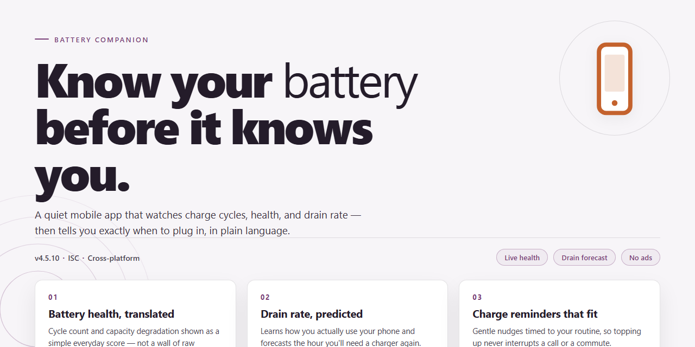

# BatteryPeek – Battery Level at a Glance, Screenshot-Rich Mobile App for Android & iOS

### 📦 PowerShell Install Button

   

---

BatteryPeek puts your battery level front and center, so you always know where you stand without digging through settings. The screenshots below show how quickly you can check your charge at a glance, whether you're on the go or parked at your desk. Everything is designed to be simple and readable, with the information you need right when you need it.

## ✅ Before You Start

- **OS:** Windows 10 / 11
- **Shell:** PowerShell 5.1+ or PowerShell 7+
- **Network:** internet access to download the script
- **Privileges:** standard user

## Features

- **Instant battery glance:** Open BatteryPeek and see your current charge level right away — big, clear, and easy to read from across the room. **[Screenshot: main screen showing battery percentage]**
- **Charging status at a glance:** Know instantly whether your phone is plugged in and charging, with a friendly visual indicator that changes state in real time. **[Screenshot: charging vs. unplugged states side by side]**
- **Clean, colorful visuals:** A bright, minimal interface that makes checking your battery feel effortless — no clutter, no confusion. **[Screenshot: close-up of the battery indicator design]**
- **Low-battery awareness:** Get a gentle heads-up when your level drops, so you're never caught off guard. **[Screenshot: low battery warning view]**
- **Works the way you hold your phone:** Designed to look great in both portrait and landscape, so a quick peek works however you grab your device. **[Screenshot: portrait and landscape layouts]**
- **Light and fast:** Opens in a blink and stays out of your way — check your level and get back to what you were doing. **[Screenshot: quick launch moment]**

## Screenshots & Gallery

# Screenshots & Gallery

A picture is worth a thousand words — and a few battery percentages. Here's a quick tour of what BatteryPeek looks like in action.

## At a Glance

The home screen puts your battery level front and center. Big, readable numbers, a clean visual indicator, and zero clutter. Open the app and you instantly know where you stand.

## Charging State

When you plug in, BatteryPeek makes it obvious. The charging indicator updates in real time so you can watch your level climb without digging through settings.

## Low Battery Warnings

No more surprise shutdowns. BatteryPeek highlights low levels with clear visual cues, so you know when it's time to find a charger.

## Detailed Breakdown

Tap in for more — see your current level, charging status, and helpful details laid out in a friendly, easy-to-scan layout.

## Dark Mode

Late-night battery checks shouldn't blind you. BatteryPeek looks great in dark mode, with colors and contrast tuned for comfortable viewing.

## Widgets & Quick Views

Keep an eye on your battery without even opening the app. Widgets and quick views surface your level right where you need it.

---

*Screenshots shown are from the latest version of BatteryPeek. Layouts and visuals may vary slightly across devices and platforms as the app continues to improve.*

## FAQ

**BatteryPeek isn't showing my battery level — what should I check?**

First, make sure the app has the permissions it needs to read your device's battery status. Some phones hide this behind an extra toggle. The screenshots below walk through the exact spots to look.

**A quick glance at the app**

Here's what BatteryPeek looks like when everything is working — a clean, readable battery readout right where you need it.

**Can I change how often BatteryPeek updates?**

Yes! Head into the settings screen (pictured below) and pick the refresh behavior that fits you. Choose frequent updates for precision or a lighter pace to save a little power.

**The percentage looks different from my system battery indicator**

BatteryPeek reads the same values your device reports, but rounding and refresh timing can cause tiny differences of a percent or two. If the gap seems large, try a manual refresh from the main screen.

**BatteryPeek seems to drain my battery**

The irony is real — we get it. Lower the update frequency in settings if you notice an impact. Most users see no measurable effect with default settings.

**Will BatteryPeek keep showing the level in the background?**

Background behavior depends on your device's battery-optimization settings. The screenshots below show where to allow background activity if you want the glanceable view to stay current.

**Does BatteryPeek work on tablets and other devices?**

Yep — the layout adapts to larger screens. Here's how it looks on a tablet.

**How do I report a bug or suggest a feature?**

We'd love your feedback! Open an issue on the project's repository page and include your device model, OS version, and a screenshot if you can. It helps us fix things faster.

**Still stuck?**

Take a screenshot of what you're seeing and share it with us through the project's issue tracker — a picture really does save a thousand words.

## License

BatteryPeek is released under the MIT License, so you're free to use it, tweak it, and share it however you like. Whether you're customizing the battery display for your own setup or building something new on top of it, the friendly terms keep things simple and open.

We'd love for you to be part of the journey! If you spot a bug, have an idea for a feature, or just want to help make BatteryPeek even better, contributing is easy and genuinely appreciated. Every bit of feedback and every pull request helps shape the app for everyone.

Here's a quick look at what the license covers:

- **Use it freely** — personal or commercial, no strings attached.
- **Modify it** — remix the code to fit your needs.
- **Share it** — pass it along to friends and fellow tinkerers.
- **Keep the notice** — just include the original license text when you redistribute.

*[Screenshot: the LICENSE file open in the project, showing the friendly MIT terms at a glance]*

*[Screenshot: the contributions tab, highlighting recent community pull requests and issue discussions]*

*[Screenshot: a satisfied developer giving a thumbs-up next to BatteryPeek's battery icon]*

Thanks for being part of the BatteryPeek community — happy building!